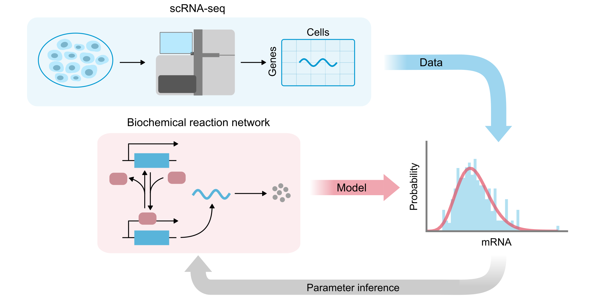

# MIG workshop: Mechanistic inference from single-cell data



### Authors: Lucy Ham, Kaan Öcal and Augustinas Sukys

| Audience      | Prerequisites | Duration    |
| ------------- | ------------- | ----------- |
| Anyone        | Install Julia | ~10 mins |
| Anyone        | Install Julia packages | ~20 mins |

## Description

This repository includes all the materials, code and resources for our workshop 'Mechanistic inference from single-cell data'.

## About the Workshop
Parameter inference is essential for interpreting empirical data and validating mechanistic models. In this workshop, we will cover the basics of parameter estimation and uncertainty quantification by fitting stochastic models of gene expression to single-cell RNA sequencing data. We will implement maximum likelihood in Julia and explore the issue of parameter identifiability along with its practical implications for model selection. We will also discuss how to distinguish the different sources of biological and technical noise present in high-throughput single-cell data.

This workshop builds on top of the fundamentals of biochemical modelling covered in October [workshop of the series](https://github.com/melbintgen/intro-biochemical-modelling). Throughout the workshop, we will use the Julia programming language and [Pluto](https://plutojl.org/) notebooks.

## Key Learning Objectives
**Mechanistic inference from single-cell data**
   - Understand the basics of calibrating models to data using maximum likelihood
   - Learn how to select a model in practice and quantify parameter uncertainty
   - Explore different types of noise present in single-cell data

## Installation Requirements

### 1. Install Julia

[`juliaup`](https://github.com/julialang/juliaup) is the recommended Julia installer and version manager that is easiest to set up via terminal:

#### macOS / Linux

```bash
curl -fsSL https://install.julialang.org | sh
```

#### Windows

Using `winget`:

```powershell
winget install --name Julia --id 9NJNWW8PVKMN -e -s msstore
```

The workshop runs on **Julia 1.13 or 1.12**. We recommend **Julia 1.13**, the version used to prepare the workshop, so install and select that version:

```bash
juliaup add 1.13
juliaup default 1.13
```

The `1.13` channel always tracks the newest 1.13.x release, so a later `juliaup update` keeps you on a supported version rather than moving you to Julia 1.14.

If you already use Julia 1.12, the workshop also works with it; make sure you have the newest 1.12 release:

```bash
juliaup add 1.12
juliaup default 1.12
```

Earlier Julia versions (1.11 and older) are not supported.

After installation, verify that Julia and `juliaup` are available:

```bash
julia --version
juliaup status
```

`julia --version` should report a `1.13` or `1.12` release.

---

### 2. Install Julia Packages

Julia's built-in package manager allows us to download and install packages from within Julia. **NOTE:** To avoid situations where different Julia-based projects require specific, potentially incompatible package versions, we install packages inside a project-specific Julia environment (instead of using the global environment for everything).

The workshop folder (this repository) already contains this environment in two files:
- `Project.toml` — records the direct project dependencies, including [Pluto.jl](https://plutojl.org), the notebook interface.
- `Manifest.toml` — records the exact package versions and the dependency tree.

From the workshop folder, open the Julia REPL with the workshop environment active:

```bash
julia --project=.
```

Then install the exact recorded package versions:

```julia
julia> using Pkg

julia> Pkg.instantiate()   # Install the package versions recorded in Manifest.toml

julia> Pkg.precompile()
```

or simply
```julia
julia> ]
pkg> instantiate
pkg> precompile
```

Unlike Python, but similarly to R, Julia frequently needs to precompile its packages. This may take a while.

---

## Launch the Pluto Notebook

From the workshop folder, run:

```bash
julia --project=. launch.jl
```

This starts Pluto and opens the workshop notebook in your web browser. If Pluto opens it in **Safe preview**, choose **Run notebook code** to enable the workshop controls. We recommend running this before the workshop to compile the notebook's code and ensure that everything works.

---

## Material

Slides: TBA

Practical: TBA

Extra resources:

* **Mathematical Modelling in Systems Biology**, by Brian Ingalls (available at this [link](https://www.math.uwaterloo.ca/~bingalls/MMSB/)): accessible and comprehensive introduction to biochemical modelling.

* **High-Performance Scientific Modeling with Julia and SciML** by Chris Rackauckas (available at this [link](https://github.com/SciML/Julia_Modeling_Workshop)): a vast teaching resource for all things scientific computing in Julia.
